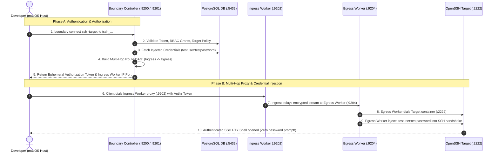

# Boundary Enterprise Multi-Hop: Complete End-to-End Deep Dive Guide

This guide breaks down every single phase, step, configuration block, and CLI parameter in the Boundary Enterprise multi-hop setup, explaining **what happens under the hood**, **why each component exists**, and **how the complete end-to-end data and control flow operates**.

---

## 🏗️ High-Level Topology & Flow



---

## Phase 1: Foundation Layer (Database & Cryptographic Keys)

### Step 1: Starting PostgreSQL Database Container

```bash
podman run -d \
  --name boundary-postgres \
  --restart always \
  -e POSTGRES_USER=boundary \
  -e POSTGRES_PASSWORD=boundary \
  -e POSTGRES_DB=boundary \
  -p 5432:5432 \
  docker.io/library/postgres:15-alpine
```

#### What this step does:
* Deploys PostgreSQL 15, which acts as the **state storage engine** for Boundary.
* Boundary does not store plaintext configuration files for scopes or targets. Everything (RBAC roles, user accounts, target definitions, worker registrations, audit events, active session metadata) is stored encrypted inside PostgreSQL tables.

#### Under the Hood:
* When initialized, Boundary creates dozens of relational tables (e.g., `scope`, `target`, `host`, `credential`, `session`, `worker`).

---

### Step 2: Cryptographic Key Management (AEAD KMS)

In `controller.hcl`, we define three symmetric AES-GCM (256-bit) AEAD keys:

```hcl
kms "aead" {
  purpose   = "root"
  aead_type = "aes-gcm"
  key       = "sP1fnF5Xz85RrXyELHFeZg9Ad2qt4Z4bgNHVGtD6ung="
  key_id    = "global_root"
}

kms "aead" {
  purpose   = "worker-auth"
  aead_type = "aes-gcm"
  key       = "OLFhJNbEb3umRjdhY15QKNEmNXokY1Iq8fZBjCUfN0T="
  key_id    = "global_worker-auth"
}

kms "aead" {
  purpose   = "recovery"
  aead_type = "aes-gcm"
  key       = "8fZBjCUfN0TzjEGLQldGY4+iE9AkOvCfjh7+p0GtRBQ="
  key_id    = "global_recovery"
}
```

#### Why we have 3 distinct KMS keys:
1. **`purpose = "root"` (Database Encryption Key)**:
   * Encrypts sensitive fields (like static passwords, Vault tokens, and internal database DEKs) before writing to PostgreSQL.
2. **`purpose = "worker-auth"` (Worker-Led Enrollment Key)**:
   * **The trust anchor between Controller and Workers**. Both the Controller and Workers possess this identical key.
   * When a worker starts, it encrypts its registration payload with this key and sends it to the Controller. Because the Controller has the matching key, it decrypts the payload and automatically trusts, registers, and activates the worker without human intervention.
3. **`purpose = "recovery"` (Break-Glass Administrative Key)**:
   * Used for emergency administrative recovery if the primary admin password or OIDC provider is unavailable.

---

## Phase 2: Control Plane (Boundary Controller)

### Step 3: Database Initialization (`boundary database init`)

```bash
boundary database init -config controller.hcl | tee init.log
```

#### What happens under the hood:
1. Connects to PostgreSQL using `database.url`.
2. Runs all database schema migrations.
3. Creates the root `global` Scope.
4. Generates an initial administrative User (`u_...`) and Password Account (`acctpw_...`) with login name `admin`.
5. Prints the generated one-time initial admin password to `init.log`.

---

### Step 4: Starting the Controller Process

```bash
boundary server -config controller.hcl > controller.log 2>&1 &
```

#### What happens under the hood:
* **API Listener (`0.0.0.0:9200`)**: Starts listening for HTTPS/HTTP API requests and serves the Admin Web UI at `http://127.0.0.1:9200/`.
* **Cluster Listener (`0.0.0.0:9201`)**: Starts an internal gRPC service where workers connect, send heartbeats, register tags, and receive session routing commands.
* **Background Scheduler**: Launches internal cron loops for session expiration timers, credential revocation, and worker health checks.

---

## Phase 3: Multi-Hop Worker Mesh Topology

### Step 5: Starting Ingress Worker (Edge / DMZ Layer)

```hcl
worker {
  name              = "worker-ingress-dmz"
  public_addr       = "127.0.0.1:9202"
  initial_upstreams = ["127.0.0.1:9201"]

  tags {
    type = ["ingress"]
    env  = ["dmz"]
  }
}

listener "tcp" {
  address     = "0.0.0.0:9202"
  purpose     = "proxy"
  tls_disable = true
}
```

#### How it works:
1. `initial_upstreams = ["127.0.0.1:9201"]`: The Ingress Worker dials the Controller's Cluster port (`9201`).
2. It sends its `worker-auth` KMS proof and registers its public address (`127.0.0.1:9202`) and metadata tags (`type=ingress, env=dmz`).
3. It opens its proxy listener on port `9202`, ready to accept incoming client connections.

---

### Step 6: Starting Egress Worker & Constructing the Multi-Hop DAG

```hcl
worker {
  name              = "worker-egress-private"
  public_addr       = "127.0.0.1:9204"

  # CRITICAL: Points upstream to Ingress Worker proxy port
  initial_upstreams = ["127.0.0.1:9202"]

  tags {
    type = ["egress"]
    env  = ["private-vpc"]
  }
}

listener "tcp" {
  address     = "0.0.0.0:9204"
  purpose     = "proxy"
  tls_disable = true
}
```

#### How the Multi-Hop Mesh is Constructed:
1. Notice `initial_upstreams = ["127.0.0.1:9202"]`: Instead of dialing the Controller, the Egress Worker connects directly to the **Ingress Worker's proxy port**.
2. The Ingress Worker forwards the registration packet to the Controller over its existing cluster channel.
3. The Controller notes: *"Worker `worker-egress-private` reached me through `worker-ingress-dmz`."*
4. **The Routing DAG (Directed Acyclic Graph) is formed**: The Controller now knows that traffic destined for the private VPC must enter via Ingress Worker (`:9202`) and relay to Egress Worker (`:9204`).

---

## Phase 4: Target Infrastructure & Identity Bindings

### Step 7: Starting Destination Target (Containerized OpenSSH)

```bash
podman run -d \
  --name ssh-target-box \
  --restart always \
  -p 2222:2222 \
  -e USER_NAME=testuser \
  -e USER_PASSWORD=testpassword \
  -e PASSWORD_ACCESS=true \
  lscr.io/linuxserver/openssh-server:latest
```

#### Why port `-p 2222:2222`:
* The LinuxServer OpenSSH container listens internally on port `2222`.
* Mapping `2222:2222` exposes the SSH daemon on host `127.0.0.1:2222`, where the Egress Worker can reach it.

---

### Step 8: CLI Authentication & Headless Keyring Handling

```bash
export BOUNDARY_ADDR="http://127.0.0.1:9200"
export BOUNDARY_KEYRING_TYPE="none"

AUTH_METHOD_ID=$(boundary auth-methods list -scope-id global -format=json | jq -r '.items[0].id')
export BOUNDARY_TOKEN=$(boundary authenticate password \
  -auth-method-id "$AUTH_METHOD_ID" \
  -login-name admin \
  -password "env://ADMIN_PASSWORD" \
  -format=json | jq -r '.item.attributes.token')
```

#### Why `BOUNDARY_KEYRING_TYPE="none"`:
* In headless Linux environments (like Lima or CI/CD), there is no graphical desktop keyring daemon (`secret-service` / `pass`).
* Setting `keyring-type=none` tells Boundary CLI to store the token in the environment (`BOUNDARY_TOKEN`) rather than failing on OS keyring access.

---

### Step 9: Creating Scope Hierarchy

```bash
# 1. Create Organization Scope
ORG_ID=$(boundary scopes create -scope-id global -name "DevOps Org" -format=json | jq -r '.item.id')

# 2. Create Project Scope
PROJECT_ID=$(boundary scopes create -scope-id "$ORG_ID" -name "Core Infrastructure" -format=json | jq -r '.item.id')
```

#### The Scope Model:
* `global`: System-wide settings, worker registrations, and top-level orgs.
* `Org` (`o_...`): Administrative tenant boundary (e.g., department, business unit).
* `Project` (`p_...`): Resource container where Targets, Host Catalogs, and Credential Stores reside.

---

### Step 10: Host Catalog, Host Set & Host Definition

```bash
# 1. Host Catalog
CATALOG_ID=$(boundary host-catalogs create static -scope-id "$PROJECT_ID" -name "VPC-Catalog" -format=json | jq -r '.item.id')

# 2. Host Set
SET_ID=$(boundary host-sets create static -host-catalog-id "$CATALOG_ID" -name "SSH-HostSet" -format=json | jq -r '.item.id')

# 3. Host
HOST_ID=$(boundary hosts create static -host-catalog-id "$CATALOG_ID" -name "internal-ssh-box" -address "127.0.0.1" -format=json | jq -r '.item.id')

# 4. Add Host to Set
boundary host-sets add-hosts -id "$SET_ID" -host "$HOST_ID"
```

#### Decoupling Hosts:
* Boundary decouples **Targets** from **Hosts**.
* Targets point to **Host Sets**, which can contain 1 host or 1,000 auto-scaled cloud instances without modifying the target policy.

---

### Step 11: Static Credential Store & Injected Password

```bash
# 1. Create Credential Store
STORE_ID=$(boundary credential-stores create static -scope-id "$PROJECT_ID" -name "SSH-CredStore" -format=json | jq -r '.item.id')

# 2. Create Username/Password Credential
CRED_ID=$(boundary credentials create username-password \
  -credential-store-id "$STORE_ID" \
  -name "SSH-User-Pass" \
  -username "testuser" \
  -password "env://SSH_PASS" \
  -format=json | jq -r '.item.id')
```

#### Why `-password "env://SSH_PASS"`:
* Boundary enforces `env://` or `file://` syntax to prevent sensitive passwords from appearing in bash history or process lists.
* This credential is stored encrypted at rest with the `root` KMS key.

---

### Step 12: Creating the Target with Ingress & Egress Filters

```bash
TARGET_ID=$(boundary targets create ssh \
  -scope-id "$PROJECT_ID" \
  -name "multihop-ssh-target" \
  -default-port 2222 \
  -session-max-seconds 28800 \
  -ingress-worker-filter '"ingress" in "/tags/type"' \
  -egress-worker-filter '"egress" in "/tags/type"' \
  -format=json | jq -r '.item.id')
```

#### Parameter Breakdown:
* `ssh`: Defines this as a Layer-7 SSH target.
* `-default-port 2222`: The destination port on the target host.
* `-session-max-seconds 28800`: Enforces an 8-hour maximum lifetime; Boundary forcibly terminates the proxy tunnel after this duration.
* `-ingress-worker-filter '"ingress" in "/tags/type"'`: Restricts the client's entry worker to nodes tagged with `type=ingress`.
* `-egress-worker-filter '"egress" in "/tags/type"'`: Restricts the outbound connection to nodes tagged with `type=egress`.

---

### Step 13: Binding Hosts & Credentials to the Target

```bash
# 1. Bind Host Set (WHERE to connect)
boundary targets add-host-sources -id "$TARGET_ID" -host-source "$SET_ID"

# 2. Bind Credential (HOW to authenticate)
boundary targets set-credential-sources -id "$TARGET_ID" -injected-application-credential-source "$CRED_ID"
```

#### Why this separation matters:
* The Target is simply a **Policy Rule**.
* Attaching `add-host-sources` provides the network destinations.
* Attaching `set-credential-sources` with `-injected-application-credential-source` enables the worker to authenticate on the wire on behalf of the user.

---

## Phase 5: Complete End-to-End Session Execution Flow

When a user executes:

```bash
boundary connect ssh -target-id "$TARGET_ID"
```

Here is the exact millisecond-by-millisecond execution sequence:

1. **Authorization Request**:
   * The Boundary CLI contacts the Controller at `127.0.0.1:9200` requesting an `authorize-session` token for `$TARGET_ID`.
2. **Policy Evaluation**:
   * The Controller verifies the user's role grants, checks `session_max_seconds`, and retrieves the injected credential (`testuser:testpassword`) from the database.
3. **Route Calculation (DAG Evaluation)**:
   * The Controller matches `-ingress-worker-filter` to `worker-ingress-dmz` and `-egress-worker-filter` to `worker-egress-private`.
   * It confirms reachability: `[worker-ingress-dmz -> worker-egress-private]`.
4. **Session Authorization Token Generated**:
   * Controller generates a single-use, short-lived authorization token containing the routing path and encrypted credential payload, returning it to the CLI.
5. **Local Listener & Client Tunnel**:
   * Boundary CLI starts a local proxy on an ephemeral port (e.g., `127.0.0.1:46139`) and connects to `worker-ingress-dmz` on `:9202`.
6. **Multi-Hop Relay**:
   * `worker-ingress-dmz` decrypts the routing header and streams the encrypted session across to `worker-egress-private` on `:9204`.
7. **Upstream Dial & Injected Authentication**:
   * `worker-egress-private` dials `127.0.0.1:2222` (the OpenSSH Podman container).
   * It decrypts the injected credential and negotiates the SSH password handshake with `sshd`.
8. **Interactive Terminal (PTY)**:
   * The SSH shell is established. The developer is dropped into `testuser@ssh-target-box:~$` with **zero password prompts and zero network exposure to the private subnet**.
