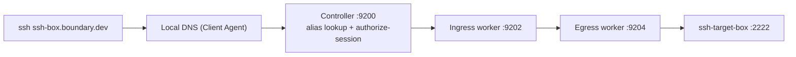

# Troubleshooting Workshop: SSH Target Aliases & Transparent Sessions

This guide extends the multi-hop lab built by [`setup.sh`](setup.sh) with **target aliases** and **transparent sessions**, and provides a set of fault-injection scenarios for a hosted troubleshooting session.

References:
* [Boundary targets overview](https://developer.hashicorp.com/boundary/docs/targets) (SSH targets, target aliases and transparent sessions)
* [Overview of target aliases](https://developer.hashicorp.com/boundary/docs/targets/configuration)
* [Configure transparent sessions](https://developer.hashicorp.com/boundary/docs/targets/configuration/configure-transparent-sessions)
* [Connect using transparent sessions](https://developer.hashicorp.com/boundary/docs/targets/connections/transparent-sessions)
* [Boundary Client Agent](https://developer.hashicorp.com/boundary/docs/api-clients/client-agent) and [its troubleshooting guide](https://developer.hashicorp.com/boundary/docs/client-agent/troubleshoot)

> **Status of the commands below:** CLI flags were checked against `boundary ... -h` on the installed Enterprise binary. The alias and transparent-session steps themselves have **not yet been run end-to-end** in this lab. Do a dry run before the session (see [Pre-flight checklist](#pre-flight-checklist)).

---

## 1. Concepts in 5 minutes

| Concept | What it is | Why it matters for troubleshooting |
|---|---|---|
| **SSH target** | Target type that is SSH-aware. Supports credential injection and optional session recording. | Our `multihop-ssh-target` already injects `testuser`/`testpassword`, so the user never types a password. |
| **Target alias** | Globally unique, DNS-like string pointing at a target (`destination_id`). Permissions are *not* tied to the alias. | Alias can exist and resolve while the user is still denied, or the destination target can be broken. |
| **Alias scope** | Global, or project scope. | Project-scope aliases need **suffixes** on both the org and project scope. Global-scope aliases need none. |
| **Alias suffix** | Single DNS label set on an org and on a project. Alias becomes `alias.projectsuffix.orgsuffix`. | Missing or wrong suffix is a common creation error. |
| **Transparent session** | User runs `ssh <alias>`. The Client Agent intercepts DNS, creates the session and proxies it. | Adds a new layer: local DNS, the Client Agent daemon, token cache, grants. |
| **Boundary Client Agent** | Local DNS daemon (macOS 14/15, Windows 11). Installed with the Boundary installer, no standalone binary. Enterprise and HCP only. | Most "alias doesn't work" cases are agent state, not Boundary config. |

Request path in this lab (layers where faults can be injected):



---

## 2. Extend the lab

Prerequisite: `./setup.sh` completed, and `source .env` gives you `ORG_ID`, `PROJECT_ID`, `TARGET_ID`, `HOST_ID`, `BOUNDARY_TOKEN`.

```bash
cd boundary-multihop-setup
source .env
```

### 2.1 Global-scope alias (simplest, no suffixes)

```bash
boundary aliases create target \
  -scope-id global \
  -name "ssh-box-global" \
  -description "Global alias for the multi-hop SSH target" \
  -value "ssh-box.boundary.dev" \
  -destination-id "$TARGET_ID" \
  -authorize-session-host-id "$HOST_ID" \
  -token env://BOUNDARY_TOKEN -keyring-type=none
```

Notes:
* Use a value containing a dot. Single-word aliases don't resolve on Windows.
* `-authorize-session-host-id` pins the alias to a specific host in the target's host set. It is optional. Omit it and Boundary picks a host.

### 2.2 Project-scope alias (requires suffixes)

```bash
# Suffix must be a single DNS label, set on BOTH the org and the project
boundary scopes set-alias-suffix -id "$ORG_ID"     -alias-suffix devops \
  -token env://BOUNDARY_TOKEN -keyring-type=none
boundary scopes set-alias-suffix -id "$PROJECT_ID" -alias-suffix core \
  -token env://BOUNDARY_TOKEN -keyring-type=none

boundary aliases create target \
  -scope-id "$PROJECT_ID" \
  -name "ssh-box-project" \
  -value "ssh-box.core.devops" \
  -destination-id "$TARGET_ID" \
  -authorize-session-host-id "$HOST_ID" \
  -token env://BOUNDARY_TOKEN -keyring-type=none

# Confirm what Boundary actually stored (verify the value includes the suffixes as expected)
boundary aliases list -scope-id "$PROJECT_ID" -token env://BOUNDARY_TOKEN -keyring-type=none
```

> Verify during the dry run whether Boundary expects the full `alias.project.org` string at creation or appends the suffixes itself. Adjust `-value` accordingly.

### 2.3 Alias at target-creation time (alternative)

`boundary targets create ssh` accepts `-with-alias-value`, `-with-alias-scope-id` and `-with-alias-authorize-session-host-id` to create the alias together with the target.

### 2.4 Connect with the alias, without the Client Agent

This works on any OS and is the baseline to prove the alias itself is good:

```bash
boundary connect ssh ssh-box.boundary.dev \
  -token env://BOUNDARY_TOKEN -keyring-type=none
```

Compare with the pre-alias form:

```bash
boundary connect ssh -target-id "$TARGET_ID" \
  -token env://BOUNDARY_TOKEN -keyring-type=none
```

### 2.5 Transparent session (Client Agent, macOS)

1. Install the Boundary clients with the **Boundary installer** (installs CLI, Desktop client and Client Agent). Remove older standalone CLI/Desktop installs first.
2. Authenticate so the agent can see the token. The lab sets `BOUNDARY_KEYRING_TYPE=none`, which does **not** store the token in a keyring. For the agent, authenticate using the default keyring instead (verify during the dry run).

   > **Use the auth method ID and password of the controller that is actually listening on `127.0.0.1:9200`.** A `404 Resource not found` from `boundary authenticate` means the `AUTH_METHOD_ID` doesn't exist on that controller. `401 Unable to authenticate` means the ID is right but the password is wrong. Both happen when `.env` or `init.log` on the Mac is left over from an earlier `setup.sh` run, while the live controller was initialised somewhere else (for example inside Lima, in that VM's own `init.log`). Get the live values with `boundary auth-methods list -scope-id global -addr http://127.0.0.1:9200`, and read the password from the `init.log` of the run that started the controller.

   ```bash
   unset BOUNDARY_KEYRING_TYPE
   export BOUNDARY_ADDR=http://127.0.0.1:9200
   boundary authenticate password \
     -auth-method-id "$AUTH_METHOD_ID" -login-name admin \
     -password "env://ADMIN_PASSWORD"
   ```
3. Check the agent: `boundary client-agent status` (expect `running` and an auth token id).
4. Wait up to ~2 minutes after creating an alias, then:

   ```bash
   ssh ssh-box.boundary.dev
   ```

   No `-p`, no password. Boundary injects `testuser` credentials.
5. Inspect: `boundary client-agent sessions` and `boundary sessions list -recursive`.

> The controller in this lab uses plain HTTP (`tls_disable = true`). Confirm during the dry run that the Client Agent accepts an `http://` controller address. If not, the transparent-session part must run against a TLS-enabled controller.

#### Running with Boundary in Podman inside a Lima VM

The Client Agent runs on the **macOS host**, never in the Lima VM or a container. Boundary itself (controller, workers, Postgres, SSH target) can run in Podman inside Lima.

What must be true:
* **Ports reachable from the Mac.** The agent talks to the controller API (`9200`) and to the ingress worker's `public_addr` (`127.0.0.1:9202`). Both must be forwarded from the Lima guest to the Mac's `127.0.0.1`. Lima's default port forwarding does this for listening ports. Check from the Mac:

  ```bash
  curl -s -o /dev/null -w "%{http_code}\n" http://127.0.0.1:9200/v1/scopes   # expect 200
  nc -z 127.0.0.1 9202 && echo ingress-ok
  ```
* **Everything else stays in the VM.** The ingress → egress → target hops (`9204`, `2222`) are dialled inside the VM, so they need no Mac-side access.
* **`public_addr` must match what the Mac can dial.** The worker configs use `127.0.0.1:9202`. That works because Lima forwards it. If you change Lima's networking (for example a bridged or `vzNAT` IP), update `public_addr` to an address the Mac can reach.
* **Where each command runs:**

  | Where | What works |
  |---|---|
  | macOS host (agent running) | `ssh <alias>` (transparent), `boundary connect ssh <alias>` |
  | Inside the Lima VM | Only `boundary connect ssh <alias>` (no Client Agent on Linux) |

* **Agent installed?** `boundary client-agent status` failing with `connection refused ... localhost:9300` means the agent isn't installed or running. `/Applications/Boundary.app` (Desktop client) alone doesn't include it. Install it with the Boundary installer.
* **Lima vs the Podman-machine scripts.** `setup.sh` and `reset.sh` manage a `boundary-podman-machine`. If you use a Lima VM instead, skip the `podman machine` lines and run the equivalent Podman commands inside Lima (`limactl shell <name> -- podman ...`).
* **Port 2222 on the host.** The `ssh-target-box` port is published inside the VM, so a host-side listener on `2222` (for example `vagrant-vmware-utility`) can conflict with Lima's forward of the same port. Check with `netstat -anv -p tcp | grep '\.2222 '`.

### 2.6 Grants for a non-admin user (optional, realistic)

Admin works for the first run. For a realistic scenario, create a role for a `trainee` user with the grants the agent needs:

```
type=auth-method;ids=*;actions=authorize
type=target;ids=*;actions=authorize-session
type=auth-token;ids=*;actions=read:self
type=user;ids=*;actions=list-resolvable-aliases
```

Do **not** delete the default anonymous login role or its auth-token grant. The Client Agent depends on it.

---

## 3. Troubleshooting scenarios

For each scenario: the facilitator injects the fault, participants diagnose from the symptom, then the fix is revealed.

### Scenario A: Alias doesn't resolve, plain DNS answer

| | |
|---|---|
| **Symptom** | `ssh ssh-box.boundary.dev` fails with `Could not resolve hostname`. |
| **Inject** | `boundary client-agent pause` (or log out / let the token expire). |
| **Diagnose** | `boundary client-agent status` shows `paused` or no auth token. `nslookup ssh-box.boundary.dev`: the server should be a CGNAT (`100.64.0.0/10`) or ULA IPv6 address when the agent is intercepting. |
| **Fix** | `boundary client-agent resume`, re-authenticate if no token. |
| **Lesson** | When the agent can't help, it defers to the normal resolver, so the failure looks like ordinary DNS. |

### Scenario B: Newly created alias doesn't work yet

| | |
|---|---|
| **Symptom** | Alias created seconds ago still doesn't resolve via `ssh`. |
| **Diagnose** | `boundary connect ssh <alias>` works, but `ssh <alias>` doesn't. The agent refreshes aliases periodically, up to ~2 min. |
| **Fix** | Wait, then retry. If it persists after 2 minutes, check the agent log (`/Library/Application Support/HashiCorp/Boundary/boundary-client-agent.log`, set `log_level` to `DEBUG` if needed). |
| **Lesson** | Distinguish alias config errors from agent cache latency. Use `boundary connect ssh <alias>` as the control. |

### Scenario C: Project alias creation fails or has the wrong form

| | |
|---|---|
| **Inject** | Remove the suffix from one scope, then try to create the project-scope alias: `boundary scopes remove-alias-suffix -id "$PROJECT_ID"`. |
| **Symptom** | Alias creation in the project scope is rejected. |
| **Diagnose** | `boundary scopes read -id <org>` and `-id <project>`: check `alias_suffix`. Both are required. |
| **Fix** | `boundary scopes set-alias-suffix` on both scopes, or create the alias in the global scope. |
| **Lesson** | Project aliases need two suffixes, global aliases need none. Suffixes make the alias globally unique across scopes. |

### Scenario D: Alias resolves, but "permission denied" / authorize-session fails

| | |
|---|---|
| **Inject** | Log in as `trainee` with a role lacking `type=target;ids=*;actions=authorize-session`. |
| **Symptom** | Agent resolves the name, notification or `ssh` shows a session failure. `boundary connect ssh <alias>` returns a 403. |
| **Diagnose** | `boundary roles list/read`, check grants and grant scope. Remember: **alias existence does not grant access**. |
| **Fix** | Add the missing grant. |
| **Lesson** | Aliases and target permissions are separate. A different team can manage aliases from the people who can use targets. |

### Scenario E: Controller overloaded / aliases not cached (missing list-resolvable-aliases)

| | |
|---|---|
| **Inject** | Remove `type=user;ids=*;actions=list-resolvable-aliases` from the trainee's role. |
| **Symptom** | Aliases resolve slowly or intermittently. Controller sees a request for every DNS lookup on the machine. |
| **Diagnose** | `controller.log`, agent log, grants on the role. |
| **Fix** | Add the grant. |
| **Lesson** | Without this grant the agent can't pre-fetch the alias list and sends every DNS query to the controller. |

### Scenario F: Alias points to the wrong or a deleted target

| | |
|---|---|
| **Inject** | `boundary aliases update target -id <alias-id> -destination-id <other-target-id>` or delete the target. |
| **Symptom** | Alias resolves but connects to the wrong place, or no longer works. |
| **Diagnose** | `boundary aliases read -id <alias-id>`: check `destination_id`. Deleting a *project* clears `destination_id` for aliases pointing into it. |
| **Fix** | Repoint with `-destination-id`. |
| **Lesson** | Aliases are loose references. Check the destination first. |

### Scenario G: Alias is fine, the downstream path is broken (multi-hop layer)

| | |
|---|---|
| **Inject** | `pkill -f worker-egress.hcl` (stop the egress worker). |
| **Symptom** | Session authorizes but the connection hangs or fails: `ssh` can't connect. Session may be "pending". |
| **Diagnose** | `boundary workers list`, `worker-egress.log`, `controller.log`. Egress worker is missing, so the egress filter `"egress" in "/tags/type"` matches nothing. |
| **Fix** | Restart: `boundary server -config worker-egress.hcl > worker-egress.log 2>&1 &`. |
| **Lesson** | Aliases and transparent sessions don't change worker routing. Fault-isolate: alias → authorization → worker path → target. |

### Scenario H: Wrong port or host/credential problem on the SSH target

| | |
|---|---|
| **Inject** | `boundary targets update ssh -id "$TARGET_ID" -default-port 22`, or change the injected credential password. |
| **Symptom** | Session starts, then `Connection refused` (port) or `Permission denied (password)` (credential). |
| **Diagnose** | Container: `podman logs ssh-target-box`, `podman ps` port mapping. Egress worker log for `connection refused`. Target: `boundary targets read -id "$TARGET_ID"`. |
| **Fix** | Restore `-default-port 2222`, correct the credential. |
| **Lesson** | Configuration changes apply only to **new** sessions. Terminate the active session and reconnect. |

### Scenario I: Alias resolves, but plain `ssh <alias>` hangs (client port mismatch)

| | |
|---|---|
| **Inject** | `boundary targets update ssh -id "$TARGET_ID" -default-client-port null` (clears the client port). |
| **Symptom** | `nslookup <alias>` returns a CGNAT address from the agent, but `ssh <alias>` fails with `connect to host <alias> port 22: Operation timed out`. `ssh -p 2222 <alias>` works. `boundary connect ssh` and the Desktop UI work. |
| **Diagnose** | `netstat -an -p tcp \| grep LISTEN \| grep 100\.` while a session is active: the agent's proxy listens on `<ip>.2222`, the target's `default_port`, not 22. Agent log line `authorizeAliasSession: ... port=2222 client_port=...` shows both ports. `boundary targets read -id "$TARGET_ID"` shows `default_client_port`. |
| **Fix** | `boundary targets update ssh -id "$TARGET_ID" -default-client-port 22`, then `boundary client-agent pause` and `resume` (or wait for the agent's refresh). Alternatively connect with `ssh -p 2222 <alias>`. |
| **Lesson** | With transparent sessions the client connects to the alias on the port the *client* uses (`default_client_port`, falling back to `default_port`). The target's backend port and the port users type are separate settings. The Desktop UI and `boundary connect` hide this by choosing a local port. |


---

## 4. Diagnostic cheat sheet

Work top-down. Stop at the first failing layer.

| Layer | Check | Command |
|---|---|---|
| 1. Name resolution | Is the agent intercepting DNS? | `nslookup <alias>` (expect CGNAT/ULA server) |
| 2. Agent | Running, authenticated, not paused? | `boundary client-agent status` |
| 3. Alias | Exists, right value and destination? | `boundary aliases list/read` |
| 4. Scope | Suffix set on org and project (project aliases)? | `boundary scopes read -id ...` |
| 5. Authorization | Grants for authorize-session / list-resolvable-aliases | `boundary roles read -id ...` |
| 6. Control path | Alias works without agent? | `boundary connect ssh <alias>` |
| 7. Workers | Both registered, filters match? | `boundary workers list`, `worker-*.log` |
| 8. Target | Port, host, credential, container up? | `boundary targets read`, `podman logs ssh-target-box` |
| 9. Sessions | Is a session being created? | `boundary sessions list -recursive`, `boundary client-agent sessions` |

Logs: `controller.log`, `worker-ingress.log`, `worker-egress.log` in this directory; agent log at `/Library/Application Support/HashiCorp/Boundary/boundary-client-agent.log`.

---

## 5. Pre-flight checklist

- [ ] Port **2222 is free on the host**. On this machine `vagrant-vmware-utility` has previously held `*:2222`, which makes `podman start ssh-target-box` fail with `bind: address already in use`. Check with `netstat -anv -p tcp | grep '\.2222 '`. If needed, halt the Vagrant VM or map a different host port and update `-default-port` on the target.
- [ ] `./setup.sh` completes and `boundary connect ssh -target-id "$TARGET_ID"` works (baseline).
- [ ] Boundary installer + Client Agent installed on the presenter machine, `boundary client-agent status` returns `running`.
- [ ] Confirmed the agent works against the lab's `http://127.0.0.1:9200` controller and with the keyring-based login (see 2.5).
- [ ] If Boundary runs in Lima: ports `9200` and `9202` are reachable from the Mac's `127.0.0.1` (see "Running with Boundary in Podman inside a Lima VM" in 2.5).
- [ ] Alias commands in section 2 dry-run successfully, including whether project-scope `-value` includes suffixes.
- [ ] Each fault in section 3 has been injected and reverted once. `./reset.sh` brings back a clean environment.

## 6. Suggested agenda (about 90 minutes)

| Time | Activity |
|---|---|
| 0:00 | Concepts (section 1), demo of baseline `boundary connect ssh -target-id` |
| 0:10 | Create aliases (2.1, 2.2), connect with alias (2.4) |
| 0:25 | Enable transparent session (2.5), live `ssh <alias>` |
| 0:35 | Scenarios A–D: facilitator injects, pairs diagnose using the cheat sheet |
| 1:00 | Scenarios E–H |
| 1:20 | Debrief: top-down diagnostic order, what changes only apply to new sessions |
